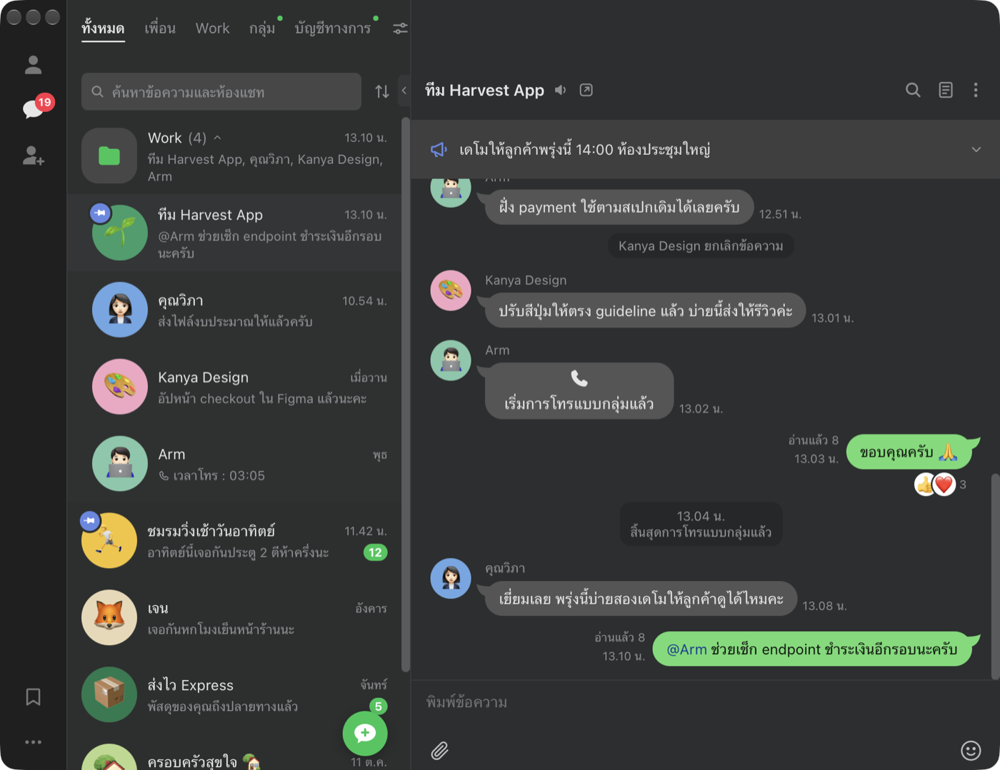

# LAAB (ลาบ)

A LINE client for macOS. It's a Tauri app (React and Rust) that talks to LINE
through [line-rs](https://github.com/softnetics/line-rs). The code is in
`desktop/`; [`desktop/README.md`](desktop/README.md) has the developer notes.



> [!WARNING]
> LAAB is not made by LINE. Using an unofficial client can break LINE's terms
> of service, and LINE can restrict or ban the account.

## Install

Download the latest `.dmg` from
[Releases](https://github.com/softnetics/laab/releases/latest), open it, and
drag LAAB.app into Applications. It needs macOS 11 or later on Apple silicon.
Releases are signed with a Developer ID and notarized by Apple.

LAAB checks for a new version at launch and every 6 hours, downloads it in
the background, and then shows a bar under the chat list. Click **รีสตาร์ต**
(Restart) to install it. This only works once LAAB is in Applications: run it
from the mounted `.dmg` or straight from Downloads and macOS starts it from a
read-only copy that can't be replaced.

To build it yourself you need Rust and pnpm:

```bash
./scripts/build-desktop.sh
open dist/LAAB.app
```

## Using it

Sign in with a QR code (scan it with LINE on your phone), or with your email
or phone number. **⌘K** searches chats, messages and file names in what has
synced so far. Right-click a chat or a message for its commands.

On first launch macOS asks whether LAAB may use the Keychain. Click **Always
Allow**; if you click Deny, LAAB can't open until you allow it. A build you
make yourself without a Developer ID certificate is signed ad hoc, and macOS
asks again after every new build.

## Your data

Everything lives in `~/Library/Application Support/Laab/`:

- `laab.sqlite` holds chats, messages, the search index and the LINE session.
  It's encrypted with SQLCipher, and the key is in the Keychain
  (`tech.softnetics.laab` / `database-key`).
- `cache/` holds photos, videos, files and profile pictures, encrypted with
  the same key. Stickers aren't encrypted because they're public files.
- A file you open in another app is a temporary copy that LAAB deletes when
  it quits. **Show in Finder** saves a copy to Downloads instead.

The cache is capped at 2 GB. Past that, LAAB deletes the files you haven't
opened for the longest time (it keeps thumbnails) and downloads them again
when you open them. A file LINE has already deleted from its servers can't
come back. You can clear the whole cache from the ⋯ menu, and signing out
clears it too.

The Raycast extension in `raycast/` reads the same database. It needs
`sqlcipher` (`brew install sqlcipher`), and macOS asks the first time whether
`security` may read the key.

## Limitations

- Much of LAAB hasn't been tried with a real LINE account yet. The list is
  in [`desktop/README.md`](desktop/README.md#not-yet-tested-with-a-real-line-account).
- LINE's protocol has no public documentation, so a change on LINE's side
  can break LAAB without warning.
- Apple silicon only.

## Releasing

Releases are built by GitHub Actions (`.github/workflows/release.yml`). The
workflow runs the tests, builds, signs and notarizes the app, and then
creates the tag and the GitHub release together. The release notes list the
commits since the previous release (`scripts/release-notes.sh`).

Start from a `main` that matches `origin/main`, with `gh` signed in:

```bash
./scripts/release.sh 0.2.0 --dry-run   # test and build the .dmg into dist/ on your Mac; no tag
./scripts/release.sh 0.2.0             # start the workflow for v0.2.0
```

`--draft` creates a draft release, and `--zip` ships a zip instead of a
`.dmg`. A version with a `-`, like `0.2.0-beta.1`, becomes a pre-release, and
installed apps don't update to pre-releases. You can also start the workflow
from the Actions tab; tick **dry run** to build and notarize without
publishing, and the files show up as a workflow artifact.

The workflow needs these repository secrets:

| Secret | Value |
| --- | --- |
| `DEVELOPER_ID_P12` | A "Developer ID Application" certificate and its private key, exported as `.p12` and base64-encoded |
| `DEVELOPER_ID_P12_PASSWORD` | The `.p12` password |
| `NOTARY_KEY_P8` | The contents of an App Store Connect API key (`AuthKey_<id>.p8`) |
| `NOTARY_KEY_ID` | That key's id |
| `NOTARY_ISSUER` | That key's issuer id |
| `TAURI_SIGNING_PRIVATE_KEY` | The updater's private key, made with `pnpm tauri signer generate`. Its public key is in `desktop/src-tauri/tauri.conf.json` |
| `TAURI_SIGNING_PRIVATE_KEY_PASSWORD` | That key's password |

Keep a backup of the updater's private key. If it's lost, installed copies of
LAAB can't update themselves any more, and everyone has to download the next
version by hand.

A dry run on your own Mac signs, notarizes and staples with the first
"Developer ID Application" certificate in your Keychain, through the
notarytool profile `laab-notary`. Create that profile once with
`xcrun notarytool store-credentials laab-notary --key AuthKey_<id>.p8 --key-id <id> --issuer <issuer id>`.

## License

GPL-3.0-or-later. See [`LICENSE`](LICENSE).
